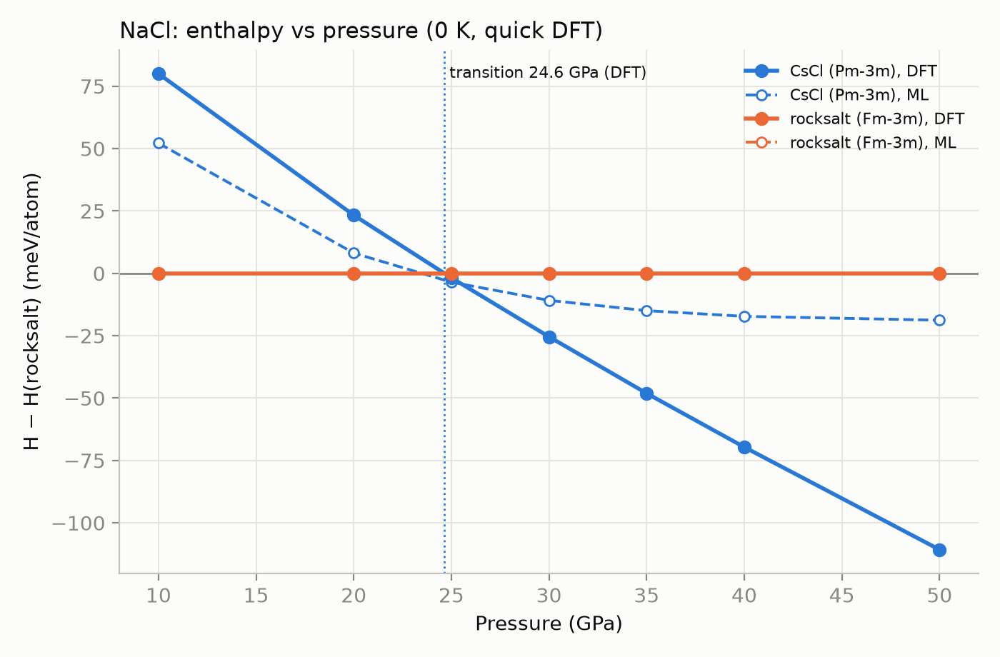

# HP-Pilot

**Find high-pressure crystal structures, and know when your fast machine-learning model is wrong.**

HP-Pilot is an open pipeline that searches for stable crystal structures under pressure. It uses machine-learning (ML) potentials for speed, and a trust check decides for each structure whether the ML answer can be trusted or needs a quantum (DFT) check.

---

## About

Under high pressure, atoms arrange into structures that never form at ambient conditions. These structures matter for planetary interiors, superhard materials and superconductors. Searching for them with DFT is accurate but slow. Universal ML potentials are fast, but they are trained mostly near ambient pressure, and their errors grow with pressure.

HP-Pilot answers one question for every candidate: **can I trust the fast model here?**

## Why use it

- **Fast where it is safe, accurate where it is not.** ML handles the search. DFT is run only on the structures the trust check flags.
- **It shows its reasons.** Every structure gets a label (Trusted or Needs DFT) and a written reason.
- **It is built for a cluster.** VASP inputs are written with high-pressure settings, checked, and split into SLURM jobs that fit the cluster's free cores.
- **It is modular.** Each stage has its own folder, its own README and a single "plug-in" file. New generators, models or checks can be added without touching other stages.

## What we found so far



- **NaCl:** DFT puts the rocksalt → CsCl transition at **24.6 GPa** (0 K, quick settings). ML gives 23.5 GPa, but it underestimates how strongly the new phase wins at higher pressure.
- **Trust limits depend on the material.** Limits fitted for silicon do not work for CaSiO₃ or NaCl. The calibration figure shows why.
- **A database test (MgVH₅, 32–90 GPa):** DFT keeps the database structure at every pressure. ML stays wrong by 160–230 meV/atom, so the trust check is needed here.


These results come from small test sets. They show what the method can do, not a proven accuracy on new materials.

## Installation

You need Python, conda, and a CPU machine. A GPU is not needed.

```bash
# 1. create the environment
conda create -y -n osi python=3.11
conda activate osi

# 2. install the packages
pip install ase pymatgen pyxtal
pip install torch --index-url https://download.pytorch.org/whl/cpu
pip install mace-torch

# 3. check the install
python 0_stage_softwares_resources_etc/check_env.py
```

DFT stages (4–5) also need a licensed **VASP** installation and your own POTCAR files. Put them in `0_stage_softwares_resources_etc/potcars/`. POTCARs are never included in this repository.

## How to use it

Run everything from the project folder:

```bash
cd 7_OSI

./hp-pilot run --composition Si --pressure 15            # stages 1-4: structures, ML relax, trust check, VASP inputs
./hp-pilot run --composition Si --pressure 15 --submit   # the same, and send VASP jobs to SLURM
./hp-pilot status                                        # are the VASP jobs finished?
./hp-pilot collect                                       # compare DFT with ML
./hp-pilot literature                                    # literature report (after the Valency search)
```

Change the material, the pressure and the settings in `config.toml`. Every stage folder has a README with an "I want to..." table that says what to change.

## Outputs: what to check

| Figure | Where | What it tells you |
|---|---|---|
| Trust plot | `3_stage_trust_check/outputs/trust_plot.png` | Which structures are Trusted and which need DFT, and why |
| Job plan | `4_stage_incar_build/outputs/job_plan.png` | How the VASP jobs are split across cores |
| DFT vs ML | `5_stage_vasp_run/outputs/dft_vs_ml.png` | Where ML and DFT disagree |
| Literature check | `6_stage_literature_check/outputs/literature_check.png` | Which predicted phases appear in the literature |
| Overview | `7_stage_compare_materials/outputs/overview.png` | The main summary across materials |
| Transition pressure | `8_stage_pressure_scan/outputs/enthalpy_vs_pressure_*.png` | Pressure at which one phase overtakes another |
| Calibration | `3_stage_trust_check/calibration/calibration.png` | How well the trust signals predict real ML errors |

Tables are in the same folders (for example `trust_report.csv`, `dft_results.csv`, `scan_*.csv`).

## Future extensions

- **Agentic workflow (atomate2-style):** let an agent plan, submit, check and rerun the stages, with each step written to a log.
- **More ML models:** add model families (MatterSim, eSEN, fine-tuned high-pressure potentials) to the committee, so it does not share one model's blind spots.
- **Better trust signals:** normalised disagreement that transfers between materials and pressures.
- **More data:** calibrate the trust limits on database series (for example HPCSD) instead of small test sets.
- **Finite temperature:** transition pressures with phonon and temperature effects.
- **More structure generators and cluster templates:** plug-in files for other generators and job schedulers.

Full list: [future_stage_wise_improvements.md](future_stage_wise_improvements.md).

## Project layout

| Folder | Purpose |
|---|---|
| `0_stage_softwares_resources_etc` | environment, checks, install logs |
| `1_stage_create_structure` | candidate structures |
| `2_stage_relax` | ML relaxation at pressure |
| `3_stage_trust_check` | trust labels, calibration, external tests |
| `4_stage_incar_build` | VASP inputs, input checks, job plan |
| `5_stage_vasp_run` | submit, check and compare VASP runs |
| `6_stage_literature_check` | literature check through Valency |
| `7_stage_compare_materials` | combined figures across materials |
| `8_stage_pressure_scan` | enthalpy vs pressure and transition pressure |

## Credits

Built with [MACE](https://github.com/ACEsuit/mace), [pymatgen](https://pymatgen.org), [ASE](https://wiki.fysik.dtu.dk/ase/) and [PyXtal](https://pyxtal.readthedocs.io). Database test structures are from the [HPCSD database](https://doi.org/10.48550/arXiv.2605.14471). They are not redistributed in this repository.

## License

MIT. See [LICENSE](LICENSE).
