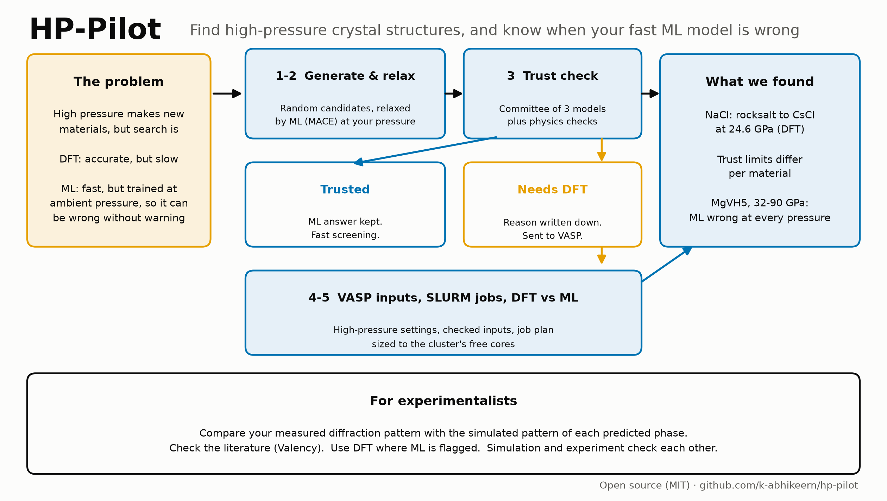
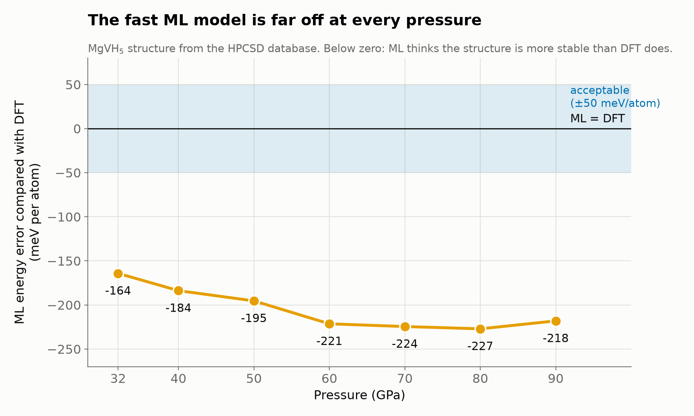
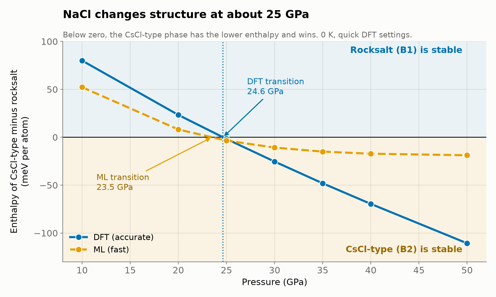
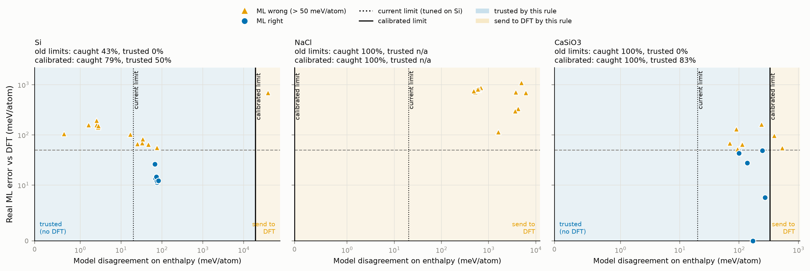
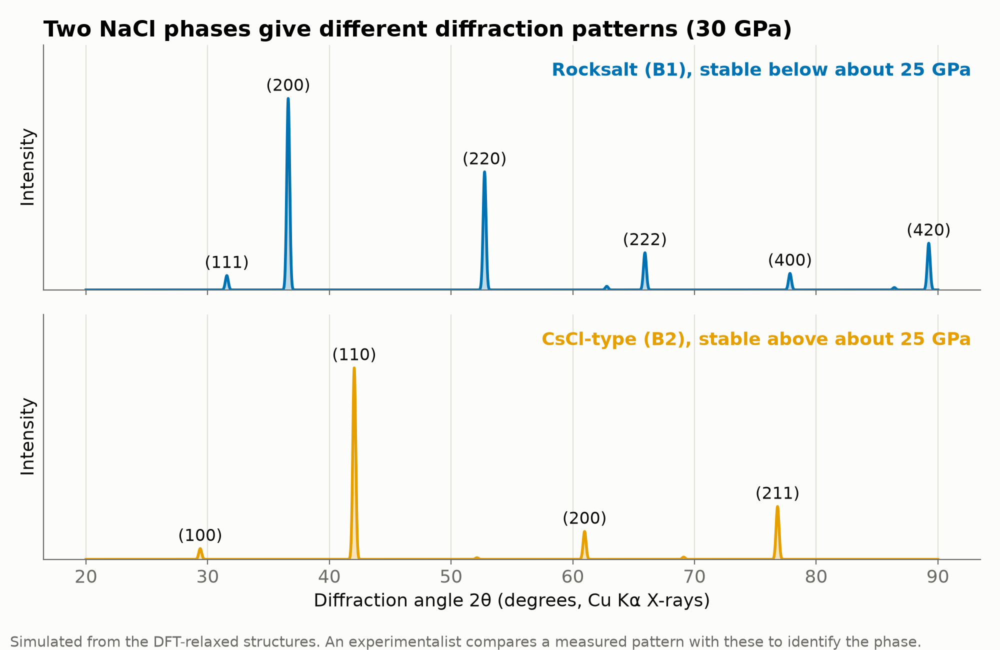

# HP-Pilot

**Find high-pressure crystal structures, and know when your fast machine-learning model is wrong.**



---

## About

Under high pressure, atoms rearrange into structures that never form at ambient conditions. These structures matter for planetary interiors, superhard materials and superconductors.

Searching for them with DFT is accurate but slow. Universal machine-learning (ML) potentials are fast, but they are trained mostly near ambient pressure, and their errors grow under compression [4].

HP-Pilot asks one question for every candidate structure: **can I trust the fast model here?**

## Why use it

- **Fast where it is safe, accurate where it is not.** ML handles the search. DFT runs only on the structures that the trust check flags.
- **Every decision has a reason.** Each structure is labelled Trusted or Needs DFT, and the reason is written next to it.
- **Built for a cluster.** VASP inputs get high-pressure settings and are checked, then split into SLURM jobs sized to the cluster's free cores.
- **Easy to extend.** Each stage has its own folder, README and plug-in file. You can add a generator, model or check without touching other stages.

## Results

**The problem is real.** For an MgVH₅ structure from the HPCSD database [1], the ML energy is off by 160–230 meV per atom at every pressure from 32 to 90 GPa.



**Phase transitions.** For NaCl, DFT puts the rocksalt → CsCl-type transition at **24.6 GPa** (0 K, quick settings). ML gives 23.5 GPa, but it underestimates how strongly the new phase wins at higher pressure.



**Trust limits depend on the material.** Limits fitted for silicon do not work for NaCl or CaSiO₃, so HP-Pilot calibrates them per material on DFT results.



**For experimentalists.** Each predicted phase comes with a simulated diffraction pattern, to compare with a measurement.



These results come from small test sets. They show what the method can do, not a proven accuracy on new materials.

## Installation

You need conda and a CPU machine. A GPU is not needed.

```bash
conda create -y -n osi python=3.11
conda activate osi
pip install ase pymatgen pyxtal
pip install torch --index-url https://download.pytorch.org/whl/cpu
pip install mace-torch
python 0_stage_softwares_resources_etc/check_env.py     # checks every package
```

The DFT stages also need a licensed **VASP** installation and your own POTCAR files, placed in `0_stage_softwares_resources_etc/potcars/`. POTCARs are never included in this repository.

## How to use it

```bash
./hp-pilot run --composition Si --pressure 15            # structures, ML relax, trust check, VASP inputs
./hp-pilot run --composition Si --pressure 15 --submit   # the same, and send VASP jobs to SLURM
./hp-pilot status                                        # are the VASP jobs finished?
./hp-pilot collect                                       # compare DFT with ML
./hp-pilot literature                                    # literature report (after the Valency search)
```

The material, pressure and other settings are in `config.toml`. Each stage folder has a README with an "I want to..." table that says what to change.

## Outputs to check

| What | File |
|---|---|
| Trusted vs Needs DFT, with reasons | `3_stage_trust_check/outputs/trust_report.csv`, `trust_plot.png` |
| VASP inputs and job plan | `4_stage_incar_build/outputs/` |
| DFT vs ML | `5_stage_vasp_run/outputs/dft_vs_ml.png`, `dft_results.csv` |
| Literature check | `6_stage_literature_check/outputs/literature_check.png` |
| Summary across materials | `7_stage_compare_materials/outputs/overview.png` |
| Transition pressure | `8_stage_pressure_scan/outputs/enthalpy_vs_pressure_*.png` |
| Trust calibration | `3_stage_trust_check/calibration/calibration.png` |

## Pipeline

| Stage | Folder | What it does |
|---|---|---|
| 1 | `1_stage_create_structure` | random symmetric candidates (PyXtal) |
| 2 | `2_stage_relax` | ML relaxation at the target pressure (MACE) |
| 3 | `3_stage_trust_check` | committee and physics checks, calibration, external tests |
| 4 | `4_stage_incar_build` | VASP inputs, input checks, job plan |
| 5 | `5_stage_vasp_run` | submit, check and compare VASP runs |
| 6 | `6_stage_literature_check` | literature check through Valency |
| 7 | `7_stage_compare_materials` | combined figures across materials |
| 8 | `8_stage_pressure_scan` | enthalpy vs pressure, transition pressure |

## Future extensions

- **Agent-driven workflows (atomate2-style):** an agent plans, submits, checks and reruns the stages, and logs every step.
- **More ML models:** add other model families (MatterSim, eSEN, pressure-transferable potentials [5]) to the committee, so it doesn't share one model's blind spots.
- **Better trust signals:** a disagreement measure that transfers between materials and pressures.
- **More data:** calibrate trust limits on database series (HPCSD [1], HPMat [3]).
- **Finite temperature:** transition pressures that include phonons.

Project notes and the full improvement list are in [`docs/`](docs/).

## References

1. Z. Wang et al., *High-pressure crystal structure database* (HPCSD), Science Bulletin 71, 4907 (2026). [doi:10.1016/j.scib.2026.08.047](https://doi.org/10.1016/j.scib.2026.08.047), [arXiv:2605.14471](https://arxiv.org/abs/2605.14471). Source of the MgVH₅ test structures (not redistributed here).
2. F. Giannessi et al., *A database of high-pressure crystal structures from hydrogen to lanthanum*, Scientific Data 11, 766 (2024). [doi:10.1038/s41597-024-03447-1](https://doi.org/10.1038/s41597-024-03447-1)
3. HPMat, High-Pressure Materials Database. [hpmat.org](https://hpmat.org)
4. A. Loew, J. Schmidt, S. Botti, M. A. L. Marques, *Universal machine learning potentials under pressure* (2025). [arXiv:2508.17792](https://arxiv.org/abs/2508.17792)
5. P.-P. De Breuck et al., *Pressure-transferable universal machine-learning potentials: the WBM-MatPES benchmark and Tuga-FF* (2026). [arXiv:2610.14891](https://arxiv.org/abs/2610.14891)
6. I. Batatia et al., *A foundation model for atomistic materials chemistry* (MACE-MP-0). [doi:10.1063/5.0297006](https://doi.org/10.1063/5.0297006), [arXiv:2401.00096](https://arxiv.org/abs/2401.00096)
7. S. Fredericks, K. Parrish, D. Sayre, Q. Zhu, *PyXtal: a Python library for crystal structure generation and symmetry analysis*, Comput. Phys. Commun. 261, 107810 (2021). [doi:10.1016/j.cpc.2020.107810](https://doi.org/10.1016/j.cpc.2020.107810)
8. S. P. Ong et al., *Python Materials Genomics (pymatgen)*, Comput. Mater. Sci. 68, 314 (2013). [doi:10.1016/j.commatsci.2012.10.028](https://doi.org/10.1016/j.commatsci.2012.10.028)
9. A. H. Larsen et al., *The atomic simulation environment (ASE)*, J. Phys.: Condens. Matter 29, 273002 (2017). [doi:10.1088/1361-648X/aa680e](https://doi.org/10.1088/1361-648X/aa680e)
10. G. Kresse, J. Furthmüller, *Efficient iterative schemes for ab initio total-energy calculations using a plane-wave basis set* (VASP), Phys. Rev. B 54, 11169 (1996). [doi:10.1103/PhysRevB.54.11169](https://doi.org/10.1103/PhysRevB.54.11169)
11. Valency, the literature search service used in stage 6 (through the Claude connector). Papers are linked in each literature report.

## License

MIT. See [LICENSE](LICENSE).
